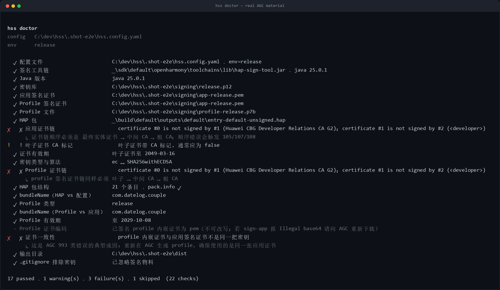
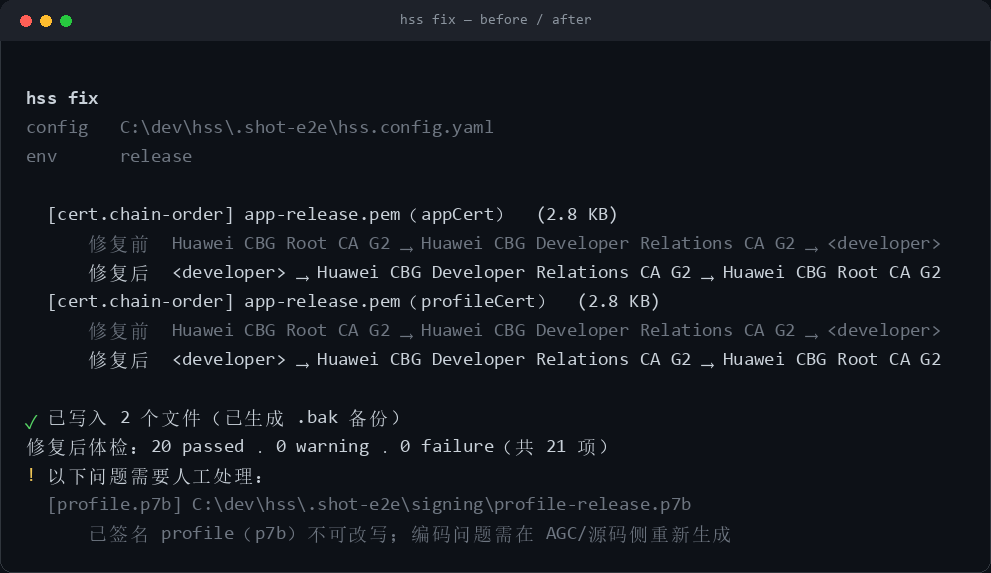
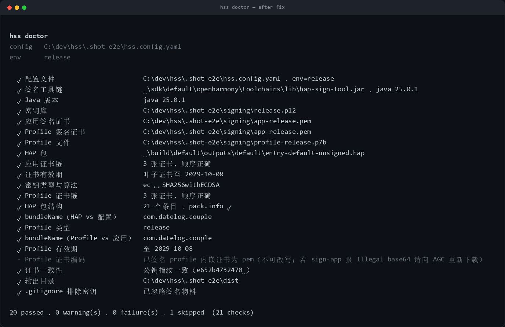

# 鸿蒙签名踩坑实录：AGC 反序证书链、base64url 的真假边界，和一个骗过我的 "not trusted"

> 环境：DevEco Studio SDK 自带 `hap-sign-tool.jar`（工具版本 1.0.0，jar 构建于 2026-08），Java 25，Windows。
> 物料：一个已上架鸿蒙应用的**真实 AGC 发布证书**（应用证书链 + release profile + 密钥库）。
> 结论均来自实测，可复现命令附在文末。

---

## 0. 起因

我在做一个鸿蒙签名自动化工具（`hss`），前面用自建 CA 跑通了整条链路，于是很自信地认为：换成 AGC 的正式物料，应该只会更顺。

结果在这套"标准答案"上，我连续踩了三个坑，其中一个还让我推翻了之前的结论。

---

## 1. 坑一：AGC 下载的 `.cer` 是反序的

从 AGC 下载的应用证书（`.cer`）是 PEM 文本，里面**不止一张证书**，而是一条三级链：

```
#0  CN=Huawei CBG Root CA G2                     ← 根
#1  CN=Huawei CBG Developer Relations CA G2      ← 中间
#2  CN=<developer>,Release                       ← 叶子（你的应用证书）
```

而 `hap-sign-tool` 的 `-appCertFile` 要求的顺序是：

```
叶子 → 中间 CA → 根
```

顺序错了会怎样？工具给出的报错是这些：

```
code 105 SignAlg params is incorrect
code 107 Wrong key usage
code 108 unable to find valid certification path to requested target
```

三个报错，没有一句提到"顺序"。我第一次看到 `107 Wrong key usage` 时，第一反应是去查证书的 KeyUsage 扩展，白白绕了很久。

**判断方法**：拿链里第 `i` 张证书去验第 `i+1` 张的签名（`checkIssued` + `verify`），第一张不成立就说明顺序不对。

```text
certificate #0 is not signed by #1 (Huawei CBG Developer Relations CA G2)
certificate #1 is not signed by #2 (<developer>,Release)
```

把整条链反转后，这三张证书的顺序校验、CA 标记、公钥一致性会一起恢复正常。

用工具跑一遍真实 AGC 物料，报错长这样（注意它同时连锁出了"CA 标记异常"和"证书一致性失败"）：



---

## 2. 坑二：`Illegal base64 character 20 / 2b` —— 但边界不是你以为的那样

先说现象。用**自己签的 profile** 去签 HAP 时：

```bash
# profile.json 里 distribution-certificate 是一段 PEM
java -jar hap-sign-tool.jar sign-profile -inFile profile.json ... -outFile app.p7b   # ✅ 成功
java -jar hap-sign-tool.jar sign-app    -profileFile app.p7b ...                     # ❌ 失败
# ERROR: 11010001 Unknown error
# Error Message: Illegal base64 character 20
```

`0x20` 是空格——PEM 头 `-----BEGIN CERTIFICATE-----` 里那两个空格。

于是我把证书改成标准 base64 再试：

```
Error Message: Illegal base64 character 2b
```

`0x2b` 是 `+`，在标准 base64 里完全合法。**这说明它用的不是标准 base64 解码器，而是 URL-safe（base64url）解码器**——在 base64url 里 `+` 和 `/` 都是非法字符。

改成无填充的 base64url（`+`→`-`、`/`→`_`、去掉 `=`）后，`sign-app` 立刻成功。

到这里，我得出一个结论：**profile 里的证书必须是 base64url**，并把它写进了工具的自动修复里。

### 然后 AGC 的 p7b 打了我的脸

拿到 AGC 预签的 `.p7b` 后我解析了一下，里面的 `distribution-certificate`：

```text
length: 1017
has PEM armor: true
first 90 chars: "-----BEGIN CERTIFICATE-----\nMIICwTCCAkegAwIBAgIOCf1Mev6jEAJV..."
```

**是 PEM**。而它在 `sign-app` 里能正常用。

于是我做了一个对照实验：用 **AGC 的 p7b**，配一把**和它毫无关系的测试密钥库**去签真实 HAP：

```bash
java -jar hap-sign-tool.jar sign-app \
  -keyAlias probe-app -keyPwd *** -signAlg SHA256withECDSA \
  -appCertFile probe-app.pem \
  -profileFile datelog-release.p7b \      # AGC 官方产物
  -inFile    entry-default-unsigned.hap \
  -keystoreFile probe.p12 -keystorePwd *** \
  -outFile  signed.hap
# → sign-app success
```

再用同样的密钥，把 profile 换成**我们自己 `sign-profile` 生成的 p7b**（内含 PEM 证书）：

```
→ ERROR: 11010001 Unknown error
  Error Message: Illegal base64 character 20
```

### 结论（也是我改掉的一处误判）

| profile 来源 | 内嵌证书格式 | sign-app 结果 |
| --- | --- | --- |
| AGC 官方 p7b | PEM | ✅ 成功 |
| 自签 p7b | PEM | ❌ Illegal base64 character 20 |
| 自签 p7b | 标准 base64 | ❌ Illegal base64 character 2b |
| 自签 p7b | base64url | ✅ 成功 |

**这个坑只存在于"你自己签 profile"的路径**，AGC 预签的 p7b 不受影响。

所以正确的工程处理是：

- 对**未签名模板**（要自己 `sign-profile` 的 JSON）：把证书字段规范成无填充 base64url，再交给工具；
- 对**已签名的 p7b**：不要动它（也动不了，签名会失效），更不该拿"编码不对"去报警。

我原来的检查项对所有 profile 都报"编码不对"，在真实 AGC 物料上就是个**假警报**。现在它对 p7b 降级为提示性 skip，只对未签名模板保留警告。

---

## 3. 坑三：`verify-app` 的 "Param is not trusted" 会骗人

`verify-app` 校验失败时经常只给一句：

```
ERROR: 11011005 Param is not trusted
Error Message: Please run java -jar hap-sign-tool.jar -h to see more help message.
```

这句提示毫无信息量，而且**容易让人误判**：

- 对一个**没有签名的 HAP** 运行 `verify-app`，它同样报 `not trusted`；
- 对自己的 CA 签出来的包，它报 `not trusted`（这个还算合理）；
- 所以它**不能**用来区分"签名结构错误"、"证书链不受信"、"这个包根本没签名"。

如果你在 CI 里把 `verify-app` 的退出码当成"签名是否成功"的唯一判据，会得到大量误报。

我的处理是把这类错误单独识别、降级为警告（不阻断出包），同时在报告里写清楚它到底在说什么；真正的签名成败以 `sign-app` 的退出码和产物为准。

---

## 4. 把坑变成工具：检查项 + 自动修复

这些坑的共同点是：**报错不指向原因，文档也不写**。所以我干脆把它们做成了检查和修复：

### 检查（节选）

| 检查项 | 抓什么 |
| --- | --- |
| `cert.app-chain-order` / `cert.profile-chain-order` | 逐张验签发关系与签名，直接说出第几张不对 |
| `cert.key-alg-match` | ECC ↔ ECDSA、RSA ↔ RSA |
| `cert.expiry` | 证书有效期，<30 天预警 |
| `profile.cert-match` | profile 内嵌证书与应用证书的**公钥指纹**是否一致 |
| `profile.cert-encoding` | 未签名模板的证书是否 base64url（p7b 跳过） |
| `hap.bundle-name` / `profile.bundle-name` | HAP、配置、profile 三方包名一致 |

### 自动修复

```text
$ hss fix
  [cert.chain-order] app-release.pem（appCert）
      修复前  Huawei CBG Root CA G2 → Huawei CBG Developer Relations CA G2 → <developer>
      修复后  <developer> → Huawei CBG Developer Relations CA G2 → Huawei CBG Root CA G2

✓ 已写入 1 个文件（已生成 .bak 备份）
修复后体检：20 passed · 0 warning · 0 failure · 1 skipped
```

真实运行效果（自动留 `.bak-<时间戳>` 备份，幂等）：



修完再体检，21 项里 20 过、1 项提示性跳过，`证书一致性` 也从失败变通过：



（`1 skipped` 就是上面说的 p7b 编码检查——已签名 profile 不可改写，只作提示。）

如果用的是未签名模板，同一个命令还会多修一项：

```text
  [profile.cert-encoding] profile-release.json
      修复前  pem
      修复后  base64url
```

修复逻辑：
- 按 `issuer → subject` 关系重排，无关联的证书移除并列出；
- 编码只改未签名模板；
- 默认写盘但一定留 `.bak-<时间戳>` 备份，幂等。

---

## 5. 错误码速查表

| 报错 | 大概率原因 |
| --- | --- |
| `code 105 SignAlg params is incorrect` | 证书密钥类型与 `-signAlg` 不匹配（ECC 配了 RSA 算法） |
| `code 107 Wrong key usage` | 证书链顺序错，或证书用途不符 |
| `code 108 unable to find valid certification path` | 链不完整 / 顺序错 / 用了错误的 CA |
| `Illegal base64 character 20` | **自签** profile 里证书是 PEM |
| `Illegal base64 character 2b` | **自签** profile 里证书是标准 base64（`+` 在 base64url 里非法） |
| `Param is not trusted` | 未签名、自建 CA、或工具信任库不含该根——**不等于签名错误** |
| `Key alias ... password error` | 生成 CA 时没给 `-keyPwd`，密钥是空口令 |
| `Please input required param` | `generate-app-cert` 少传了 `-issuer` |

---

## 6. 可复现实验

```bash
# 1. 看链的顺序（逐张验签发关系）
openssl crl2pkcs7 -nocrl -certfile app-release.cer | openssl pkcs7 -print_certs -noout

# 2. 确认工具版本
java -jar hap-sign-tool.jar -version

# 3. 对照实验：AGC p7b 配无关密钥库
java -jar hap-sign-tool.jar sign-app -mode localSign \
  -keyAlias <probe> -keyPwd *** -signAlg SHA256withECDSA \
  -appCertFile probe.pem -profileFile <agc.p7b> \
  -inFile app-unsigned.hap -keystoreFile probe.p12 -keystorePwd *** \
  -outFile signed.hap

# 4. 对照实验：自签 p7b（PEM 证书）
#    sign-profile 用 PEM 模板 → sign-app 必然报 Illegal base64 character 20
```

---

## 7. 附：把包发到 npm，也踩了三个新坑

工具做完了总得发出去。结果 2026 年的 npm 发布流程也变了，顺手记录一下（这部分跟鸿蒙无关，但同样是"报错不说人话"）：

### 坑 A：发布强制 2FA

账号 2FA 关闭时直接：

```
npm error code E403
npm error 403 Forbidden - PUT https://registry.npmjs.org/<pkg>
npm error 403 Two-factor authentication or granular access token with bypass 2fa enabled
npm error 403 is required to publish packages.
```

注意：**登录时的邮箱验证码不算 2FA**。`npm profile get` 里 `two-factor auth: disabled` 才是真相。

### 坑 B：TOTP 已经不能新开了

按老教程执行：

```
npm profile enable-2fa auth-and-writes
npm error 404 Not Found - POST https://registry.npmjs.org/-/npm/v1/user
npm error 404 Adding a new TOTP 2FA is no longer supported.
```

npm 现在只接受**安全密钥 / 通行密钥**（Windows Hello、Touch ID、YubiKey）。去设置页添加即可：

```
https://www.npmjs.com/settings/<用户名>/tfa
```

### 坑 C：新包首发走 staged publishing

有了 2FA 之后，`npm publish` 仍然可能在非交互环境里失败（CLI 会弹浏览器挑战，但 CI / 脚本接不住）。新包首次发布更稳的路径是 **staged publishing**：

```bash
npm stage publish --access public     # 入队，输出 stage id
npm stage list                        # 等到 status: staged（校验约 30-60s）
npm stage approve <stage-id>          # 打开浏览器完成安全密钥验证
```

还有一个坑：刚入队时状态是 `validating`，这时候 approve 会返回 `404 staged version not found`——**要等状态变成 `staged` 再批准**。

### 后续：CI 不要再塞 token 了

npm 的政策路线很明确：

- 2026-08 起，绕过 2FA 的 GAT 不能再做账号/权限类操作；
- **2027-01 起，绕过 2FA 的 GAT 不能再直接发布**；
- 推荐路径是 **Trusted Publishing（OIDC）**：CI 用 `id-token: write` + `npm publish --provenance`，不需要任何 token。

所以工具仓库的 `release.yml` 最终改成了：

```yaml
permissions:
  contents: read
  id-token: write
steps:
  - run: npm install && npm test && npm run build
  - run: npm publish --provenance --access public
```

再配一次包设置里的 trusted publisher（owner / repo / workflow）就完事。

> 小结一句：**当"发布"本身开始需要一行行试错时，就说明它值得被写进 checklist。** 项目里 `docs/RELEASE.md` 现在就是这份清单。

---

## 8. 小结

1. **AGC 的 `.cer` 可能是反序的**（根→中间→叶子），先验签发关系再下结论。
2. **base64url 的坑只属于自签 profile**，别把它套到 AGC 的 p7b 上——这是我这次最主要的自我修正。
3. **`not trusted` 不是签名成败的判据**，它只说明工具不认可这条信任链。
4. 报错不指向原因时，把它做成检查项和自动修复，比写一篇笔记更有价值。

工具是开源的：`hss`（`init` / `keygen` / `doctor` / `fix` / `sign` / `verify`），已发布到 npm：

```bash
npm i -g harmony-sign-suite
# 或
npx harmony-sign-suite@latest --help
```

仓库：<https://github.com/D-sp-wq/harmony-sign-suite>

上面所有结论都有对应的测试与回归用例。

> 如果你在 AGC 物料上遇到不同的行为，尤其是不同 `hap-sign-tool` 版本下 base64url 的边界，欢迎带着版本号来对一下——这类"版本相关的隐式约定"最值得记录。
